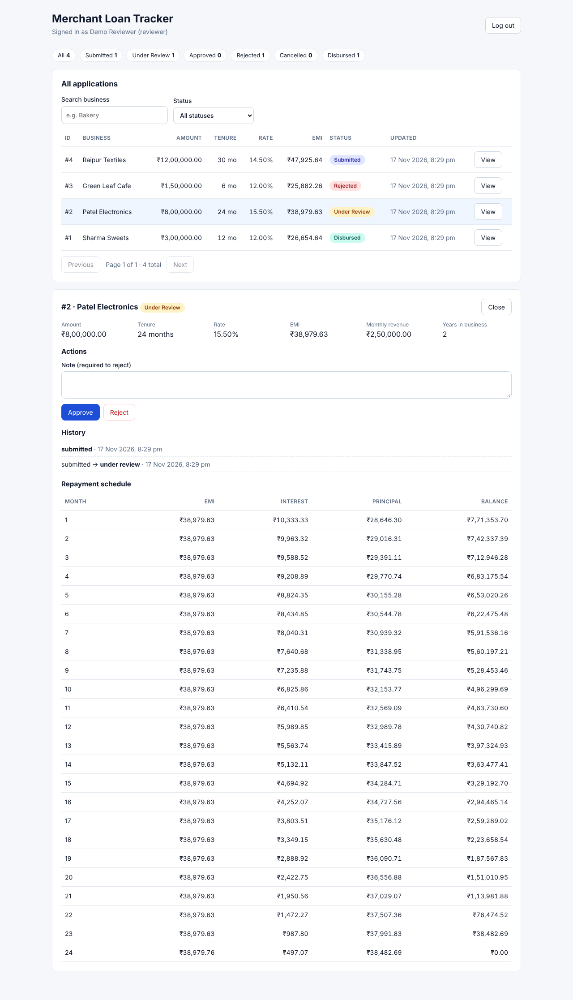
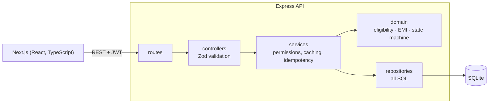
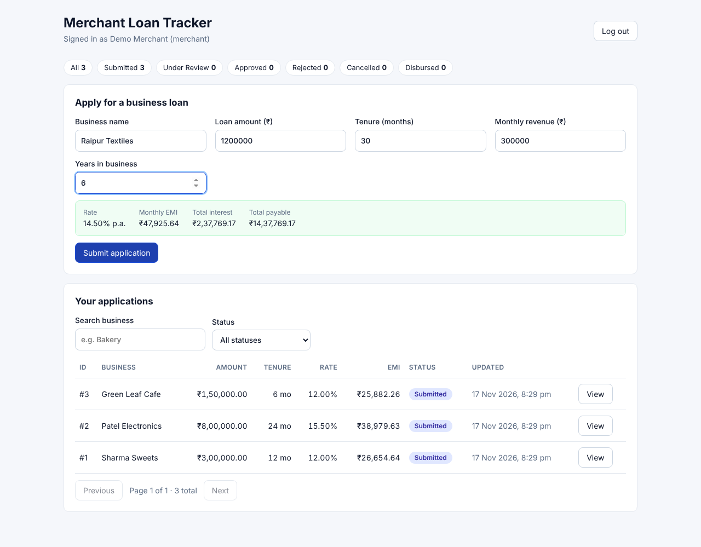
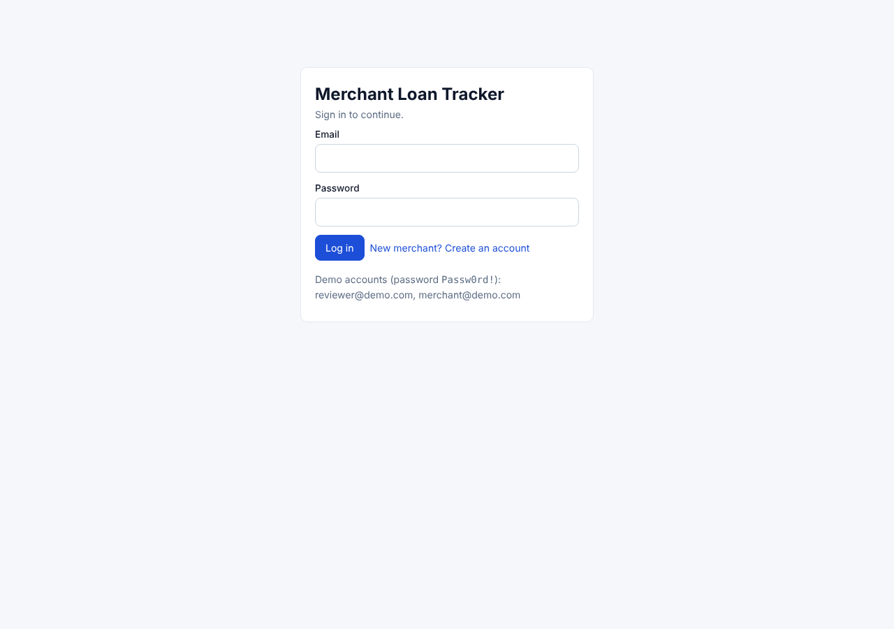

# Merchant Loan Tracker

A full-stack loan-origination app for small businesses. A merchant applies for a business loan and sees an instant, risk-based quote. The API checks eligibility, prices the loan and builds a full EMI repayment schedule. A reviewer then moves the application through an approval workflow, and every status change is recorded in an audit trail.

**Stack:** TypeScript · Next.js (React) · Node.js · Express · SQLite (SQL) · Zod · JWT + bcrypt · Jest + Supertest · Playwright · GitHub Actions



## Features

| Area | What it does |
|---|---|
| Live quote | Rate, EMI, total interest and total payable update as the merchant types (debounced), before anything is saved |
| Eligibility rules engine | Pure, unit-tested functions. Reports *every* failing rule and adds risk-based pricing to a 12% base rate |
| EMI and amortization | Standard reducing-balance formula. Money is stored as **integer paise** so there are no floating-point errors, and the schedule always ends at exactly ₹0 |
| Approval workflow | State machine: `SUBMITTED → UNDER_REVIEW → APPROVED → DISBURSED`, plus reject (reason required) and cancel (merchant, before review only). Only the approve/reject note becomes the application's `decisionNote`; every note is kept in the audit trail |
| Concurrency safety | Status changes use compare-and-swap (`UPDATE … WHERE id = ? AND status = ?`), so two reviewers can't overwrite each other. Racing sign-ups or idempotent creates are caught by `UNIQUE` constraints and answered with a clean 409/replay, never a 500 |
| Audit trail | Each status change and its event row are written in **one database transaction**|
| Idempotency | `Idempotency-Key` header on create: a retried request returns the original loan instead of a duplicate. Reusing a key for a different request returns 409 |
| Auth and access control | bcrypt-hashed passwords, JWT, merchant and reviewer roles. Merchants can't see each other's loans (404, so ids can't be probed). Login takes the same time whether or not the email exists |
| Security basics | Zod validation on every input, parameterized SQL, `CHECK` constraints on every status column, Helmet headers, CORS allow-list, login rate limiting (proxy-aware via `TRUST_PROXY`), 10 KB body limit, HTML stripped from names. Secure by default: without `NODE_ENV=development`/`test` the API runs as production (no demo users, `JWT_SECRET` required) |
| Performance | Pagination, status filter and search backed by SQL indexes. TTL cache on the summary endpoint, cleared on every write. Details panel is code-split and lazy-loaded with `next/dynamic` |
| Observability | `X-Request-Id` on every response (a caller's id is reused only if it is UUID-like and at most 64 characters), one structured JSON log line per request, `/health` endpoint, graceful shutdown with a 10-second forced exit |

## Architecture



Each layer has one job. Business rules live in `domain/` as pure functions with no I/O. All SQL lives in `repositories/`, so swapping SQLite for PostgreSQL means rewriting only that folder.

## API

All routes except auth and health need `Authorization: Bearer <token>`.

| Method | Path | Who | Purpose |
|---|---|---|---|
| POST | `/api/auth/register` | anyone | Create a merchant account |
| POST | `/api/auth/login` | anyone | Get a JWT |
| GET | `/api/auth/me` | any | Current user |
| POST | `/api/applications/quote` | merchant | Eligibility, rate and EMI without saving |
| POST | `/api/applications` | merchant | Apply (supports `Idempotency-Key`) |
| GET | `/api/applications?page=&limit=&status=&search=` | any | Paginated list (merchants see only their own) |
| GET | `/api/applications/:id` | owner / reviewer | Details and the actions this user may take |
| GET | `/api/applications/:id/schedule` | owner / reviewer | Month-by-month repayment schedule |
| GET | `/api/applications/:id/events` | owner / reviewer | Audit trail |
| POST | `/api/applications/:id/transition` | depends on target | `{ "to": "APPROVED", "note": "…" }` |
| GET | `/api/summary` | any | Count per status (cached, `X-Cache: HIT/MISS`) |
| GET | `/health` | anyone | Liveness check |

## Run it locally

You need **Node.js 22.9 or newer** (see `.nvmrc`). Check with `node -v`.

```bash
# Terminal 1: API on http://localhost:4000
cd backend
npm install
npm run dev

# Terminal 2: web app on http://localhost:3000
cd frontend
npm install
npm run dev
```

Demo accounts (password `Passw0rd!`): `reviewer@demo.com` and `merchant@demo.com`, or register a new merchant.

`npm run dev` and `npm start` run the API with `NODE_ENV=development`, which seeds the demo users and allows the dev-only JWT secret.

## Configuration

Backend settings (see `backend/.env.example`; put them in `backend/.env` or the environment):

| Variable | Default | Meaning |
|---|---|---|
| `NODE_ENV` | `production` when unset | `development` or `test` enable demo users and the dev-only JWT secret. **Anything else, including no value, is production.** `npm run start:prod` sets `production` |
| `JWT_SECRET` | none (dev-only secret in development/test) | Required in production; the API refuses to start without it |
| `PORT` | `4000` | API port |
| `DB_PATH` | `loan-tracker.db` | SQLite file, or `:memory:` |
| `ALLOWED_ORIGINS` | `http://localhost:3000` | Comma-separated CORS allow-list |
| `TRUST_PROXY` | `false` | Express `trust proxy`: `true`, a hop count such as `1`, or addresses/subnets such as `loopback, 10.0.0.0/8`. Set it behind a load balancer so rate limiting sees real client IPs |

Frontend: `NEXT_PUBLIC_API_URL` (default `http://localhost:4000`), see `frontend/.env.example`.

The schema is created on startup with `CREATE TABLE IF NOT EXISTS`, so after a schema change delete your local `backend/loan-tracker.db` (and its `-wal`/`-shm` files) to get the new constraints.

## Tests

```bash
cd backend
npm run typecheck
npm test                 # 44 Jest tests: domain rules, config, API (Supertest, in-memory DB), constraints, races
npm run test:coverage    # ~97% line coverage

cd ../frontend
npm run lint
npm run typecheck        # next typegen && tsc --noEmit
npm run build
npx playwright install chromium   # first time only
npm run test:e2e         # starts both servers, then runs the full merchant → reviewer flow in a browser
```

GitHub Actions runs all of this on every push (`.github/workflows/ci.yml`).

## Project structure

```
backend/
  src/
    config/        env settings
    db/            SQLite schema (tables, constraints, indexes)
    domain/        eligibility.ts, emi.ts, stateMachine.ts (pure business logic)
    models/        shared TypeScript types
    repositories/  all SQL (users, applications, audit events)
    services/      auth and application use cases
    controllers/   HTTP <-> service, Zod schemas
    routes/        URL wiring
    middleware/    auth, errors, rate limit, request logging
    utils/         AppError, JWT, TTL cache, validation and DB-error helpers
    app.ts         builds the Express app (used by tests)
    index.ts       starts the server
  tests/           domain.test.ts, api.test.ts
frontend/
  app/             page.tsx (login/register), dashboard/page.tsx
  components/      ApplyForm, ApplicationDetails (lazy), StatusBadge
  lib/             api.ts (typed fetch client), session.ts
  e2e/             Playwright test
```

## Design notes and trade-offs

- **Why paise and basis points?** `0.1 + 0.2 !== 0.3` in JavaScript. Integers keep every rupee exact.
- **Why SQL?** Loans are relational and need constraints (foreign keys, `UNIQUE (merchant_id, idempotency_key)`, `CHECK`s on amounts, roles and statuses) and transactions. SQLite needs no setup; the repository layer keeps it swappable.
- **Why is a missing `NODE_ENV` treated as production?** Forgetting one variable on a server should not create a reviewer account with a public password or sign tokens with a known secret. Local scripts opt in to development explicitly.
- **Why 404 instead of 403** for another merchant's loan? A 403 would confirm that the id exists.
- **Known limits (demo scope):** the JWT is stored in `localStorage` (production would use an httpOnly, Secure cookie with CSRF protection). The cache and rate limiter are in-memory, so multiple instances would need Redis. There's no file upload or KYC.

## Screenshots

| Apply with live quote | Sign in |
|---|---|
|  |  |
